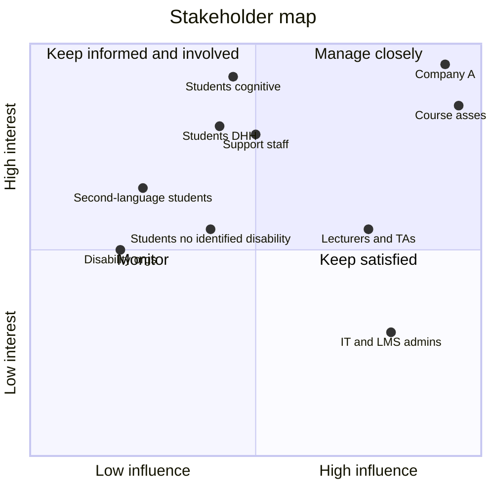

# 1. Stakeholders and accessibility barriers

## 1.1 Problem statement

Ashesi students do more and more of their learning in the browser: LMS course pages, PDFs and readings, recorded lectures, quizzes and assignment instructions. These materials usually assume one way of taking in information: dense text, a busy page layout, and spoken content in videos. Students who process text differently, who find it hard to stay focused on cluttered pages, or who cannot rely on audio get the same material but **less access to it**.

The Intelligent and Inclusive Classroom vision rejects separate digital classrooms. Our job is to give **every student** flexible ways to adapt the same page, without making anyone identify as disabled to use them.

## 1.2 Stakeholders

| Stakeholder | Role in the project | Interest | Influence | How we engage them |
|---|---|---|---|---|
| Students with cognitive or learning differences (diagnosed or not) | Primary users | Very high | Medium | Personas, voluntary usability sessions (Sprint 2, Sprint 4) |
| Students who are deaf or hard of hearing | Primary users (hearing layer) | High | Medium | Personas, caption and transcript evaluation |
| Students without an identified disability | Primary users (Universal Design) | Medium | Medium | Usability sessions. Check that features aren't stigmatising |
| International students and those reading in a second language | Primary users | Medium–high | Low | Persona, test simplification features |
| Lecturers and teaching assistants | Content authors, secondary users | Medium | High | Persona, short interview about how they prepare materials |
| Student support / accessibility coordination staff | Support stakeholders, advocates | High | Medium | Interview about accommodation requests and disclosure |
| Ashesi IT / LMS administrators | Gatekeepers for deployment | Low–medium | High | Check browser and extension policy on campus machines |
| Company A (visual module) | Partner sharing the platform | Very high | Very high | Weekly joint integration meeting (required) |
| Course lecturer / assessor | Client and examiner | High | Very high | Sprint reviews |
| Disability organisations in Ghana, e.g. Ghana National Association of the Deaf | Possible co-design and validation partners | Medium | Low (for this project) | Future work: mentioned in ethics and limitations |
| Third-party content providers (YouTube, publishers, LMS vendor) | Own content we can't change | Low | High | Note as a compatibility boundary |

## 1.3 Accessibility barriers

The brief says we must separate barriers a **browser plugin can reduce** from those that need the **content author or platform** to change. The last column records that split.

Fix types: **✅ Plugin**, the browser can reduce it fully or mostly. **🟡 Partial**, the plugin helps but can't fully solve it. **❌ Author**, it needs a change to the source content, HTML, media or backend. For ❌ items the plugin should *detect and report* the problem, not hide it.

### Cognitive and learning barriers

| ID | Barrier | Where it shows up | Who is affected | WCAG 2.2 reference | Fix type |
|---|---|---|---|---|---|
| B-C1 | Visual clutter: sidebars, banners, animations and notices compete with the main content | LMS course pages, news-style readings | Attention differences, fatigue, everyone under stress | 2.2.2 Pause, Stop, Hide · 2.3.3 Animation from Interactions (AAA) | ✅ Plugin (reading mode, hide non-essential regions, stop motion) |
| B-C2 | Dense text with tight spacing and long lines | Readings, PDFs rendered as HTML, assignment briefs | Dyslexia, low reading stamina, second-language readers | 1.4.8 Visual Presentation (AAA) · 1.4.12 Text Spacing | ✅ Plugin (spacing, line height, line length, font) |
| B-C3 | Long, unstructured pages with no sense of how much is left | Lecture notes, policy documents | Attention, working memory, anxiety | 2.4.6 Headings and Labels · 1.3.1 Info and Relationships | 🟡 Partial (we can chunk and show progress; we can't add structure the author left out) |
| B-C4 | Complex wording and multi-step instructions in one paragraph | Assignment and quiz instructions | Cognitive differences, second-language readers, everyone | 3.1.5 Reading Level (AAA) · 3.3.2 Labels or Instructions | 🟡 Partial (heuristic step splitting; opt-in AI simplification with the original always shown) |
| B-C5 | Losing your place when switching or zooming views | Any long page | Attention, memory | Supports FR12 | ✅ Plugin (core position preservation) |
| B-C6 | Time pressure from timed quizzes and auto-advancing content | LMS quizzes, carousels | Processing speed, anxiety | 2.2.1 Timing Adjustable | ❌ Author/platform for quiz timers. ✅ for pausing auto-advancing UI |
| B-C7 | Inconsistent navigation and help across courses | Course-to-course LMS layouts | Memory, orientation | 3.2.3 Consistent Navigation · 3.2.6 Consistent Help | ❌ Author/platform. The plugin only gives a consistent *toolbar* experience |

### Hearing barriers

| ID | Barrier | Where it shows up | Who is affected | WCAG 2.2 reference | Fix type |
|---|---|---|---|---|---|
| B-H1 | Captions exist but are hard to read: small, low contrast, or covering slide content | HTML5 lecture videos with caption tracks | Deaf/HoH students, students in noisy spaces, second-language students | 1.2.2 Captions (Prerecorded) | ✅ Plugin (re-render captions with user styling and position) |
| B-H2 | No transcript to search, skim or review | Recorded lectures | Deaf/HoH students, revision for everyone | 1.2.1 / 1.2.3 media alternatives | ✅ Plugin if a caption track exists (build transcript from cues) |
| B-H3 | Media has **no** captions | Uploaded lecture recordings, external videos | Deaf/HoH students | 1.2.2 Captions (Prerecorded) | ❌ Author for the MVP. The plugin detects and flags it and gives the lecturer a report. Automatic captioning is future work |
| B-H4 | Important sounds with no visual equivalent (notification chimes, "time almost up" beeps, autoplaying audio) | LMS notifications, quiz warnings, embedded media | Deaf/HoH students, anyone with sound off | 1.4.2 Audio Control | 🟡 Partial (we can detect HTML media playback; Web Audio and OS sounds are outside our reach) |
| B-H5 | Cross-origin embedded players (e.g. YouTube iframes) | Embedded videos | Deaf/HoH students | — | ❌ Out of MVP scope. Documented compatibility boundary |
| B-H6 | Live, unscripted verbal announcements in the physical classroom | In-person lectures | Deaf/HoH students | — | ❌ Outside a browser plugin's reach. Covered by the wider classroom ecosystem (Prosit 1 recommendations) |

### Barriers in the plugin itself (we must not create new ones)

| ID | Risk | WCAG 2.2 reference | Mitigation |
|---|---|---|---|
| B-P1 | Toolbar covers the element that has keyboard focus | 2.4.11 Focus Not Obscured (Minimum), new in 2.2 | Toolbar docks to an edge and shifts page content instead of overlaying it. Collapses when not in use |
| B-P2 | Controls too small for motor or tremor users | 2.5.8 Target Size (Minimum), new in 2.2 | All controls at least 24×24 CSS px; we aim for 44×44 |
| B-P3 | Keyboard shortcuts that clash with screen readers or the browser | 2.1.4 Character Key Shortcuts | Use `chrome.commands` with a modifier key; users can rebind |
| B-P4 | Too many options become a cognitive barrier in themselves | 3.3.2, general COGA guidance | Progressive disclosure: three to four quick presets first, details behind "More settings" |
| B-P5 | Labelling features by disability ("Dyslexia mode") stigmatises users | Ethical design NFR | Name features by **what they do** ("Focus", "Easier reading", "Captions"), never by diagnosis |

## 1.4 Evidence and assumptions

These barriers come from the brief, our Prosit 1 research on hearing accessibility, WCAG 2.2, and the W3C *Making Content Usable for People with Cognitive and Learning Disabilities* guidance. Anything not yet confirmed with Ashesi users is marked *Assumption* in the personas. We plan to check those through short voluntary interviews. Participants won't be asked to disclose any diagnosis, as the brief's ethics guidance requires.

**Relevant legal and policy frameworks** (for the ethics section): Ghana's Persons with Disability Act, 2006 (Act 715); the UN Convention on the Rights of Persons with Disabilities, which Ghana has ratified; and WCAG 2.2 as the technical benchmark.
