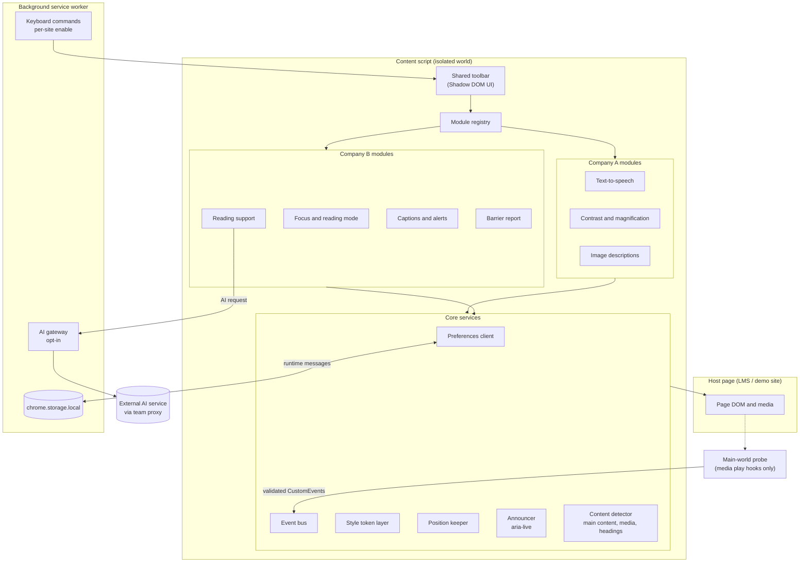
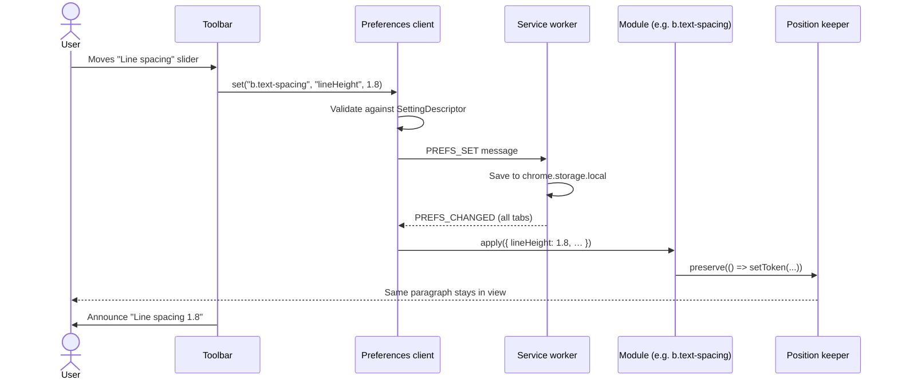
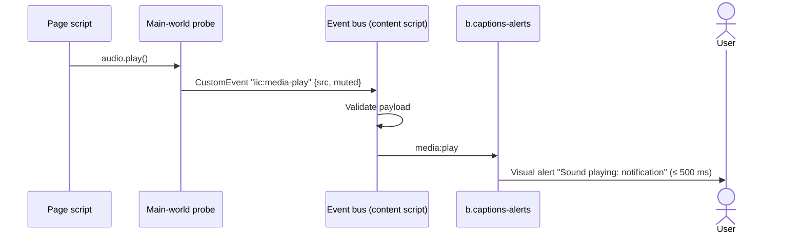

# 4. Shared architecture, interface and APIs

**Status:** Company B's **proposal** for the joint integration meeting with Company A. Items marked **🔶 needs agreement** must be decided together before Sprint 2 starts. Once agreed, this document becomes the shared contract (`apiVersion: 1`).

## 1. Design principles

1. **One plugin, one toolbar, one preferences store.** Modules add features; they never ship their own UI shell or storage.
2. **Modules depend on the core contract, never on each other.** Company A and Company B can build in parallel.
3. **Reversible by default.** Every change to the page can be undone exactly, which is needed for reset (FR13) and turning the plugin off.
4. **Fail visibly, fail locally.** A broken module or unsupported page shows a message. It never breaks the toolbar or the host page.
5. **Least privilege, no tracking.** Request only the permissions we need; store only preferences.
6. **The plugin is accessible itself.** WCAG 2.2 AA for every piece of UI we inject.

## 2. Proposed technology stack 🔶

| Concern | Proposal | Why |
|---|---|---|
| Browser | **Google Chrome (latest stable)**, Chromium-based; Edge as best-effort | Brief requires one Chromium browser; Chrome is the most common on campus *(to confirm)* |
| Extension platform | **Manifest V3** | Required for new Chrome extensions |
| Language | **TypeScript** | The module contract is enforced at compile time across both companies |
| Build | **Vite** + an MV3 plugin (e.g. CRXJS) or plain esbuild | Fast reload during development; one build for all modules |
| Toolbar UI | **Plain Web Components or Preact inside a Shadow DOM** | Shadow DOM isolates our styles from the host page and the host page's styles from us. Preact keeps the bundle small |
| Storage | `chrome.storage.local` | Stays on the device; no account needed |
| Testing | Vitest (unit), Playwright with the extension loaded (end-to-end), axe-core (automated a11y) + manual NVDA/keyboard testing | Covers the brief's evaluation requirements |
| Repo | **One shared monorepo** (pnpm workspaces) with folders owned by each company | One install, one build, one demo; integration problems show up early |

## 3. Architecture overview

This follows the brief's diagram (§4.1): learning environment → shared toolbar → specialised modules → shared services.



**Where things run**

| Context | Responsibilities |
|---|---|
| **Content script (isolated world)** | Toolbar, module registry, all modules, core services. One instance per tab. |
| **Main-world probe** (small, optional) | Only hooks `HTMLMediaElement.prototype.play` so we know when page audio starts (E6 alerts). Sends events out; receives nothing in. |
| **Service worker** | Preference storage, keyboard commands, per-site enable/disable, AI gateway. No DOM access. |
| **Options page** | Full settings, export/import, privacy explanation, AI opt-in. |

## 4. Module contract and core API 🔶

This is the most important agreement. Both companies build against these interfaces only.

### 4.1 Module definition

```ts
// packages/core/src/contract.ts  — apiVersion 1

export interface IicModule {
  /** Stable, namespaced id: "a.tts", "b.reading-mode" */
  id: string;
  owner: 'A' | 'B' | 'core';
  apiVersion: 1;
  /** Label shown in toolbar. Describes WHAT it does, never who it is for. */
  title: string;
  /** Toolbar group, so features are grouped by purpose rather than by company */
  group: 'reading' | 'focus' | 'see' | 'hear' | 'tools';
  /** Settings this module owns; the core stores and validates them */
  settings: SettingDescriptor[];
  /** Controls rendered by the shared toolbar (modules do not render their own toolbar UI) */
  controls: ControlDescriptor[];

  /** Called once per page after the DOM is ready */
  init(ctx: ModuleContext): void | Promise<void>;
  /** Called with this module's current settings whenever they change */
  apply(settings: Record<string, SettingValue>): void | Promise<void>;
  /** Undo every change this module made to the page */
  teardown(): void | Promise<void>;
}

export type SettingValue = boolean | number | string;

export interface SettingDescriptor {
  key: string;                       // "lineHeight"
  type: 'boolean' | 'number' | 'enum' | 'string';
  default: SettingValue;
  min?: number; max?: number; step?: number;
  options?: { value: string; label: string }[];
}

export type ControlDescriptor =
  | { kind: 'toggle'; setting: string; label: string; description?: string }
  | { kind: 'slider'; setting: string; label: string; unit?: string }
  | { kind: 'select'; setting: string; label: string }
  | { kind: 'action'; id: string; label: string; run: () => void | Promise<void> }
  | { kind: 'panel'; id: string; label: string; render: (root: ShadowRoot) => () => void };
```

### 4.2 What the core gives each module

```ts
export interface ModuleContext {
  prefs: {
    get(): Record<string, SettingValue>;
    set(key: string, value: SettingValue): Promise<void>;   // own keys only
  };
  bus: {
    on<E extends keyof BusEvents>(e: E, fn: (p: BusEvents[E]) => void): () => void;
    emit<E extends keyof BusEvents>(e: E, payload: BusEvents[E]): void;
  };
  /** Write CSS custom properties / scoped rules through the core; never inject <style> directly */
  style: {
    setToken(name: StyleToken, value: string | null): void;
    addRules(id: string, css: string): void;    // auto-removed on teardown
  };
  /** Keep the reader's place across layout changes (FR12) */
  position: { preserve<T>(change: () => T | Promise<T>): Promise<T> };
  /** Polite or assertive screen-reader announcements via a shared live region */
  announce(message: string, priority?: 'polite' | 'assertive'): void;
  /** Shared page analysis so both companies don't re-scan the DOM */
  detect: {
    mainContent(): Element | null;
    headings(): HTMLHeadingElement[];
    media(): HTMLMediaElement[];
    images(): HTMLImageElement[];
  };
  /** Show a non-blocking message in the toolbar */
  notify(message: string, kind?: 'info' | 'warning' | 'error'): void;
  /** Present only when the user has opted in to AI features */
  ai?: AiClient;
  log: Pick<Console, 'debug' | 'warn' | 'error'>;
}

export interface BusEvents {
  'prefs:changed':   { moduleId: string; key: string; value: SettingValue };
  'page:ready':      { url: string };
  'page:mutated':    { addedNodes: number };      // throttled MutationObserver
  'media:play':      { element: HTMLMediaElement; hasCaptions: boolean; muted: boolean };
  'media:missing-captions': { element: HTMLMediaElement };
  'module:error':    { moduleId: string; message: string };
  'reading:position':{ anchorText: string; progress: number };
}
```

### 4.3 Registering a module

```ts
// modules/b-cognitive/src/reading-mode.ts
import { defineModule } from '@iic/core';

export default defineModule({
  id: 'b.reading-mode',
  owner: 'B',
  apiVersion: 1,
  title: 'Reading mode',
  group: 'focus',
  settings: [{ key: 'enabled', type: 'boolean', default: false }],
  controls: [{ kind: 'toggle', setting: 'enabled', label: 'Reading mode',
               description: 'Show only the main content in a clean layout' }],
  init(ctx) { /* … */ },
  async apply({ enabled }) { /* use ctx.position.preserve(...) */ },
  teardown() { /* restore page */ },
});
```

The core wraps every `init`, `apply` and `teardown` call in error handling. If one throws, the core emits `module:error`, shows a toolbar notice, and keeps the other modules running (AC-E3.2).

## 5. Preferences and style ownership

### 5.1 Preference schema 🔶

```jsonc
// chrome.storage.local → key "iic.prefs"
{
  "schemaVersion": 1,
  "enabledGlobally": true,
  "disabledSites": ["example.com"],          // per-site off switch
  "activePreset": "focus",                    // or null
  "modules": {
    "b.reading-mode": { "enabled": true },
    "b.text-spacing": { "lineHeight": 1.8, "letterSpacing": 0.05, "wordSpacing": 0.1 },
    "b.captions":     { "size": "large", "position": "top", "background": "solid" },
    "a.contrast":     { "mode": "dark-high" }
  },
  "ai": { "optedIn": false }
}
```

- **Presets** are named bundles of module settings, by function: *Focus*, *Easier reading*, *Captions on*, *Larger and clearer* (from Company A). A user can start from a preset and change anything.
- **Migrations:** when `schemaVersion` changes, the core migrates old data. Unknown keys are dropped and invalid values fall back to defaults (input validation NFR).
- **No personal data** is stored: no names, emails, browsing history or AI inputs.

### 5.2 Style ownership 🔶

Both modules change how text looks, so we must agree who owns what to avoid conflicts. All visual changes go through **CSS custom properties** managed by the core, inside one cascade layer (`@layer iic`).

| Token | Owner | Notes |
|---|---|---|
| `--iic-font-scale` | **A** (text enlargement) | B never changes font size |
| `--iic-font-family` | **Shared** 🔶 | Proposal: B owns readable-font choice, A owns nothing here; or core-owned with one control |
| `--iic-line-height`, `--iic-letter-spacing`, `--iic-word-spacing`, `--iic-paragraph-spacing` | **B** | WCAG 1.4.12 spacing |
| `--iic-max-line-length` | **B** | |
| `--iic-fg`, `--iic-bg`, `--iic-link`, `--iic-contrast-mode` | **A** | B's reading mode *reads* these so dark/high-contrast also applies in reading mode |
| `--iic-focus-ring` | **Core** | Visible focus indicator for all plugin UI |
| `--iic-motion` (`reduce` / `normal`) | **B** (stop motion) | Core also honours `prefers-reduced-motion` |

**Rule:** a module may *read* any token but may only *set* the tokens it owns. The core rejects other writes and logs a warning.

## 6. Permissions and privacy

| Permission | Why | Required? |
|---|---|---|
| `storage` | Save preferences | Required |
| `activeTab` + `scripting` | Inject into the current tab when the user opens the toolbar from the extension icon | Required |
| Host access to the **demo site** | Run automatically on the shared demo site | Required |
| Host access to the **Ashesi LMS domain** 🔶 | Run automatically on the real LMS | Optional, requested at runtime |
| `<all_urls>` | Run automatically everywhere | **Optional only**, requested when the user chooses "Always run on all sites" |
| Host access to the **AI proxy** | AI features | Optional, requested when the user opts in to AI |
| `tabCapture`, `microphone` | — | **Not requested** (no auto-captioning in MVP) |

**Privacy rules**

- No analytics, telemetry or remote logging.
- AI features: off by default; send **only the text the user selected**, no URL, no page title, no identifiers; nothing stored on our side; the opt-in screen explains this (AC-E5.6).
- Messages from the main-world probe are treated as untrusted. The content script checks the event type and payload shape before acting.
- Pages are never sent anywhere for "accessibility analysis". All detection runs locally.

## 7. Performance and reliability

| Budget | Target |
|---|---|
| Content-script bundle (core + all modules, gzipped) | ≤ 150 KB; AI and transcript code loaded only when used |
| Extra page load time with plugin on | ≤ 100 ms (median of 10 loads) |
| Toolbar opening | ≤ 100 ms after keypress |
| Settings change applied | ≤ 200 ms on a 5,000-word page |
| MutationObserver work | Throttled; at most once per 250 ms |

**Graceful handling**

| Situation | Behaviour |
|---|---|
| Restricted page (`chrome://`, Chrome Web Store, built-in PDF viewer) | Extension icon popup says "The toolbar can't run on this page" and links to the compatibility list |
| Reading mode finds no main content | Message plus fallback to "Hide distractions" (AC-E4.4) |
| Video in a cross-origin iframe | Badge: "Captions for embedded players aren't supported yet" |
| AI service times out (10 s) or is offline | "Not available right now"; deterministic features keep working |
| A module throws | Toolbar notice; other modules unaffected (AC-E3.2) |

## 8. Intelligent services (hybrid)

| Feature | Approach | Runs where | Fallback |
|---|---|---|---|
| Main-content extraction | Deterministic (Readability-style heuristics) | Local | Hide-distractions mode |
| Chunking and reading time | Deterministic (headings, word count, user reading speed) | Local | — |
| Instructions as steps | Deterministic pattern detection | Local | Show original |
| Readability flags | Deterministic metrics (sentence length, word length) | Local | — |
| Simplify passage | **LLM**, opt-in | AI gateway → team proxy → provider | Deterministic step split / original text |
| Key points | **LLM**, opt-in | Same | Show section headings as an outline |

**AI gateway design**

- The **service worker** owns all AI calls. Modules only see `ctx.ai.simplify(text)` / `ctx.ai.keyPoints(text)`.
- Calls go to a **small team-run proxy** (e.g. a serverless function) that holds the API key, so **no secret ships inside the extension**. The proxy rate-limits and doesn't log request bodies.
- The provider sits behind an adapter, so the model can be changed without touching modules.
- Input is capped (e.g. 2,000 words per request) and the prompt tells the model to keep facts, numbers and terms, and to say when it isn't sure.
- Output is always labelled "AI-generated" and shown next to the original (AC-E5.7).
- **Justification for the brief:** simplification and summarisation are where deterministic methods do poorly and language models do well. Everything else is deterministic because it's more predictable, private and testable.

## 9. Key data flows

### 9.1 User changes a setting



### 9.2 Page plays a sound (visual alert)



## 10. Repository and workflow 🔶

```
iic-plugin/                      (one shared repo)
├── packages/
│   └── core/                    toolbar, registry, prefs, style tokens, detectors   [joint]
├── modules/
│   ├── a-visual/                Company A
│   └── b-cognitive-hearing/     Company B
├── extension/                   manifest, service worker, options page, build      [joint]
├── demo-site/                   shared demo LMS pages + test media                 [joint]
├── docs/                        requirements, architecture, ADRs, test reports
└── .github/                     CI: typecheck, unit tests, axe, Playwright
```

- **Branching:** `main` is protected; feature branches; pull requests need one reviewer. Changes to `packages/core` need one reviewer **from each company**.
- **Contract changes:** any change to `contract.ts` needs a short decision record in `docs/adr/` and is discussed at the weekly joint meeting.
- **Issues and boards:** each company has its own board; shared epics (E1–E3, E8) are tracked on a joint board or with a `shared` label.

## 11. Decisions needed at the joint meeting

| # | Decision | Company B proposal |
|---|---|---|
| D1 | Target browser | Chrome stable; Edge best-effort |
| D2 | Monorepo vs separate repos | One monorepo with company-owned folders |
| D3 | Language and UI approach | TypeScript; Preact or Web Components in Shadow DOM |
| D4 | Module contract (§4) | Adopt as `apiVersion: 1` |
| D5 | Preference schema and presets (§5.1) | Adopt; presets named by function |
| D6 | Style token ownership, especially font family (§5.2) | Table as written; font family owned by B |
| D7 | Toolbar layout and grouping | Group by purpose (Reading / Focus / See / Hear / Tools), not by company |
| D8 | Keyboard command for the toolbar | Alt+Shift+A, rebindable through `chrome.commands` |
| D9 | Demo environment content and hosting | Static demo LMS on GitHub Pages, contents as in E3 |
| D10 | Shared Definition of Done | As in document 3 §6 |
| D11 | AI proxy ownership and provider | Company B hosts the proxy; Company A can use it for image descriptions |
| D12 | Integration cadence | Weekly joint meeting plus a shared integration branch merged into `main` at least twice per sprint |
